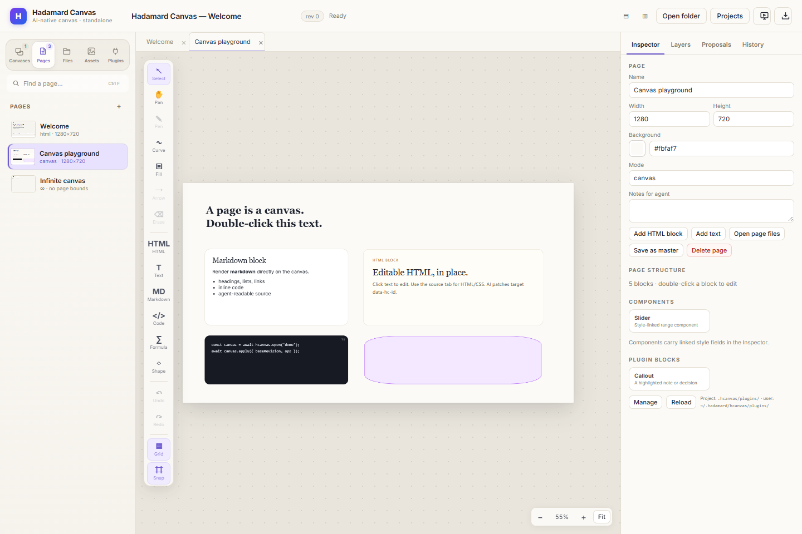

# Hadamard Harness & Canvas

[English](./README.md) | [中文](./README-zh.md)

**Hadamard Canvas（Hcanvas）** 是一个面向工程与科研工作的本地优先 AI 原生画布。它是 Hadamard 仓库中的独立画布产品：人类和 Agent 共用同一份文档模型，既有桌面应用，也提供供 Agent 直接读取和修改的 CLI/HTTP 接口。

Hadamard 是一系列围绕 LLM Harness 展开的工具：**Hadamard Harness** 提供面向工程和科研的 agent runtime、工作流与桥接能力，**Hadamard Canvas** 则是独立的可视化工作台，未来还会有更多互补工具。Hadamard Harness 的安装与开发说明已移到 [docs/zh/hadamard-harness.md](./docs/zh/hadamard-harness.md)。

  

<em>Hcanvas：一份本地文档，人和 Agent 编辑同样的页面、块和 HTML。</em>

## 为什么用 Hcanvas

大多数可视化工具最终要么只面向人，要么只面向 Agent。Hcanvas 坚持一份本地文档模型：

- **人**可以拖拽、排版，直接编辑 HTML/CSS，使用形状、图片和演示模式。
- **Agent**可以使用 JSON-first 的 CLI/HTTP 协议，借助稳定 ID、patch、修订历史和提案机制工作。
- **两者**编辑同一批页面，不需要导出成另一种格式。

Hcanvas 独立运行，拥有自己的版本（0.1.2）和 release tag（hcanvas-v*）；它独立于 Hadamard 桌面 GUI 及其旧版 Canvas 模块。

## 主要能力

### 适合不同工作的页面类型

- **HTML 页面**：沙箱渲染，可原地编辑文本/样式，也可打开源码编辑器。
- **Canvas 页面**：固定尺寸的幻灯片/页面画布。
- **Infinite 页面**：无边界坐标，可自由缩放和平移。
- **Markdown 文档页**：适合长文、论文和研究报告。
- 页面拖拽排序、缩略图、页面母版。

### 完整的内容工具箱

- HTML、文本、Markdown、代码、图片、LaTeX/MathML 公式和 66 个 PPT 风格形状。
- 曲线、箭头、手绘、frame、连接线，支持原生控制点和绑定关系。
- Markdown 富文本编辑、公式编辑和源码模式。
- 内联实时取色器，支持饱和度/色相调整与屏幕取色。
- 内置 **Inter**、**Source Serif 4**、**JetBrains Mono**，并提供系统字体选项。
- 内置 **Slider** 组件和声明式插件块；支持页面模板插件。

### Agent 原生设计

- CLI-first 协议，可读取、修改和审阅文档。
- HTML 使用稳定的 data-hc-id，Canvas 内容使用稳定 block ID。
- 实时 Agent 在线状态与光标显示。
- 提案机制，应用前可以先审阅。
- 有上限的修订历史，支持恢复和对比。

### 面向交付

- HTML、PDF、PNG、视觉 PPTX、可编辑 PPTX 和 DOCX 导出。
- 全屏演示，支持演讲者备注和文档阅读布局。
- 本地文件、资源与项目目录，无需云账户。
- 中英文界面，可在 **Projects** 页面切换。
- 全局数据位置可配置，保存在安装目录之外。

## 运行 Hcanvas

### 桌面安装包

从 [GitHub Releases](https://github.com/DeconBear/hadamard/releases) 下载独立 Hcanvas 构建，查找 hcanvas-v0.1.2 release：

- **Windows：**Hadamard-Canvas-Setup-*.exe 安装包或 Hadamard-Canvas-*-portable.exe 便携版
- **macOS：**Hadamard-Canvas-*.dmg 或 Hadamard-Canvas-*.zip（x64 与 arm64）
- **Linux：**Hadamard-Canvas-*.AppImage 或 Hadamard-Canvas-*.deb（x64）

桌面安装包只包含 Electron 应用，**不会**把 `hcanvas` / `hadamard-canvas` 加入 PATH。如果你需要 CLI 和 Agent 命令，仍需单独安装 npm 包（见下一节）。

### npm

通过 npm 或源码运行 Hcanvas 需要 Node.js 22.13+ 或 Node.js 24。

~~~bash
npm install -g hadamard-canvas
hcanvas desktop --workspace C:\Users\<you>\hcanvas
~~~

不做全局安装时，也可以通过 npm 临时运行：

~~~bash
npx hadamard-canvas desktop --workspace C:\Users\<you>\hcanvas
~~~

`hadamard-canvas` 包提供 `hadamard-canvas`、`hcanvas`、`hcanvas-desktop` 三个 CLI 入口，也提供浏览器运行方式：

~~~bash
hcanvas app --workspace <目录>       # 本地服务 + 浏览器界面
hcanvas serve --workspace <目录> --port 4319
~~~

### 从源码运行

~~~bash
npm install
npm run build
node bin/hcanvas-desktop.js --workspace ./hcanvas-demo
~~~

### 数据与项目

默认情况下，Hcanvas 将文档保存在 ~/.hcanvas。**Projects** 页面可以注册项目目录、在新窗口打开项目，并修改全局数据位置。Windows 上的应用设置位于：

~~~text
%APPDATA%\Hadamard Canvas\hcanvas-settings.json
~~~

每个项目的数据保存在项目目录下的 .hcanvas/ 中。

## 文档

- Hcanvas 完整指南：[docs/zh/hadamard-canvas.md](./docs/zh/hadamard-canvas.md)
- Hcanvas English docs: [docs/en/hadamard-canvas.md](./docs/en/hadamard-canvas.md)
- Hadamard harness 安装与开发：[docs/zh/hadamard-harness.md](./docs/zh/hadamard-harness.md) · [English](./docs/en/hadamard-harness.md)
- 文档站：https://deconbear.github.io/hadamard/
- Harness 教程：[docs/zh/README.md](./docs/zh/README.md) · [docs/en/README.md](./docs/en/README.md)
- 安全政策：[SECURITY.md](./SECURITY.md)

## Hadamard Harness

**Hadamard Harness** 是 Hadamard 系列中探索性的 agent harness：一套 TypeScript runtime，提供持久会话、工具、skills、memory、MCP、多 agent workflow，并可桥接已安装的 agent CLI（Claude Code、Codex、Cursor、Pi、CodeWhale、Reasonix、Crush），同时提供终端和桌面界面。

它仍处于探索阶段，API 和界面还会变化。Hcanvas 是同一系列中的独立可视化工具；如果你要找的是 runtime、SDK、TUI 或桌面 harness，请从这里开始：

- [Hadamard Harness：安装与开发](./docs/zh/hadamard-harness.md)
- [Hadamard harness English docs](./docs/en/hadamard-harness.md)

## 参与贡献

欢迎贡献。发现问题或文档缺失，请提交 Issue 或 Pull Request。

基于 [MIT License](./LICENSE) 许可。
