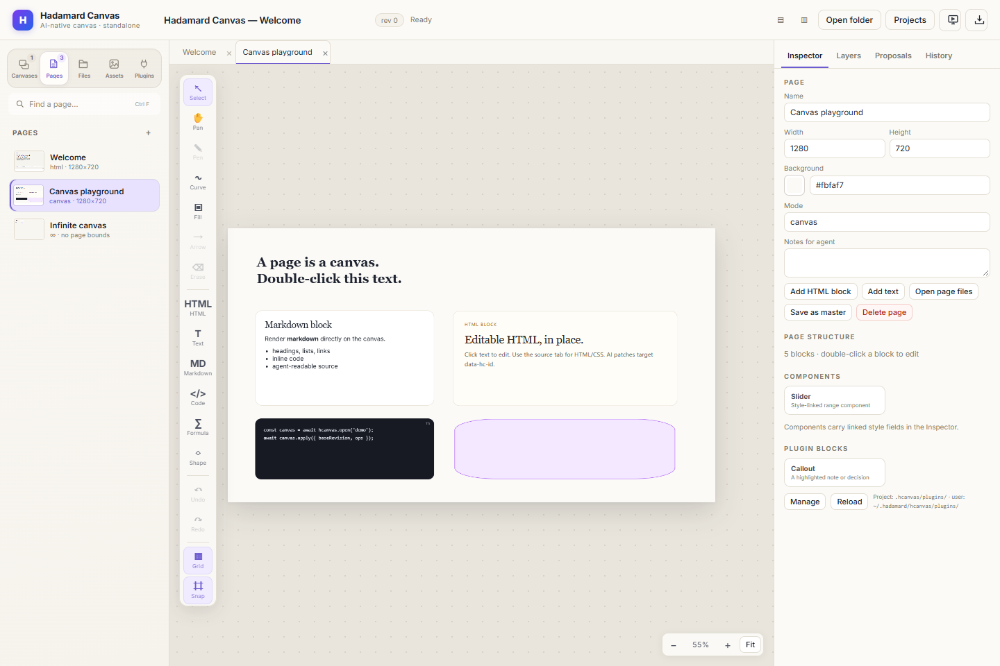

# Hadamard Harness & Canvas

[English](./README.md) | [Chinese](./README-zh.md)

**Hadamard Canvas (Hcanvas)** is a local-first, AI-native canvas for engineering and research work. It is the standalone canvas product in the Hadamard repository: one document model for humans and agents, a desktop app, and a small CLI/HTTP surface that agents can read and patch directly.

Hadamard itself is the experimental harness we are exploring for engineering and research. Hcanvas is the focused product surface for visual documents; the harness provides the broader agent runtime, workflows and bridges. Install and development notes for the harness have moved to [docs/en/hadamard-harness.md](./docs/en/hadamard-harness.md).

  

<em>Hcanvas: a local document where people and agents edit the same pages, blocks and HTML.</em>

## Why Hcanvas

Most visual tools end up either human-only or agent-only. Hcanvas keeps a single local document model:

- **Humans** get direct manipulation, real typography, HTML/CSS, shapes, images and presentation.
- **Agents** get a JSON-first CLI/HTTP protocol with stable IDs, patches, revisions and execution proposals.
- **Both** work on the same pages without exporting to a second format.

Hcanvas runs as its own app and keeps its own version (0.1.2) and release tags (hcanvas-v*); it is independent from the Hadamard desktop GUI and its legacy canvas module.

## Highlights

### Pages that fit the work

- **HTML pages** rendered in a sandbox, editable in place or in a source editor.
- **Canvas pages** with a fixed-size slide/page surface.
- **Infinite pages** with unbounded coordinates and pan/zoom.
- **Markdown document pages** for long-form notes, papers and reports.
- Drag-to-reorder page deck, page thumbnails and page masters.

### A real content toolbox

- HTML, text, Markdown, code, images, LaTeX/MathML formulas and 66 PPT-style shapes.
- Curve, arrow, freehand, frame and connector tools with native points and bindings.
- Markdown rich editing, formula editing and source mode.
- Live inline color picker with saturation/hue controls and screen eyedropper.
- Bundled **Inter**, **Source Serif 4** and **JetBrains Mono**, plus system font choices.
- Built-in **Slider** component and declarative plugin blocks; page-template plugins.

### Agent-native by design

- A CLI-first protocol for reading, patching and reviewing documents.
- Stable data-hc-id targets for HTML and block-level IDs for canvas content.
- Live agent presence and cursor tracking.
- Proposals that can be reviewed before applying.
- Bounded revision history with restore and diff.

### Built for delivery

- HTML, PDF, PNG, visual PPTX, editable PPTX and DOCX export.
- Full-screen presentation with speaker notes and a reading layout for documents.
- Local files, assets and project folders; no cloud account required.
- English and Chinese UI, switchable from the **Projects** page.
- Configurable global data location, kept outside the install directory.

## Run Hcanvas

### Windows installer and portable app

Download the standalone Hcanvas build from [GitHub Releases](https://github.com/DeconBear/hadamard/releases) — look for the hcanvas-v0.1.2 release and choose the installer (Hadamard-Canvas-Setup-*.exe) or portable executable.

### npm

Node.js 22.13+ or Node.js 24 is required when running Hcanvas from npm or source.

~~~bash
npm install -g hadamard-canvas
hcanvas desktop --workspace C:\Users\<you>\hcanvas
~~~

Or run it through npm without a global install:

~~~bash
npx hadamard-canvas desktop --workspace C:\Users\<you>\hcanvas
~~~

The `hadamard-canvas` package exposes the `hadamard-canvas`, `hcanvas` and `hcanvas-desktop` CLI entries. It also provides the browser workflow:

~~~bash
hcanvas app --workspace <dir>       # local server + browser UI
hcanvas serve --workspace <dir> --port 4319
~~~

### From source

~~~bash
npm install
npm run build
node bin/hcanvas-desktop.js --workspace ./hcanvas-demo
~~~

### Data and projects

By default Hcanvas stores documents under ~/.hcanvas. The **Projects** page can register project folders, open them in separate windows and change the global data location. On Windows, app settings live under:

~~~text
%APPDATA%\Hadamard Canvas\hcanvas-settings.json
~~~

Each project keeps its data in .hcanvas/ inside the project folder.

## Documentation

- Hcanvas full guide: [docs/en/hadamard-canvas.md](./docs/en/hadamard-canvas.md)
- Hcanvas 中文文档: [docs/zh/hadamard-canvas.md](./docs/zh/hadamard-canvas.md)
- Hadamard harness installation and development: [docs/en/hadamard-harness.md](./docs/en/hadamard-harness.md) · [中文](./docs/zh/hadamard-harness.md)
- Docs site: https://deconbear.github.io/hadamard/
- Harness tutorial: [docs/en/README.md](./docs/en/README.md) · [docs/zh/README.md](./docs/zh/README.md)
- Security policy: [SECURITY.md](./SECURITY.md)

## The Hadamard harness

Hadamard is the experimental harness we are building for engineering and research: a TypeScript agent runtime with durable sessions, tools, skills, memory, MCP, multi-agent workflows, a bridge to installed agent CLIs (Claude Code, Codex, Cursor, Pi, CodeWhale, Reasonix, Crush), and terminal/desktop surfaces.

It is intentionally exploratory — APIs and surfaces are still moving. Hcanvas is the standalone visual product in the same repository; if you are looking for the runtime layer, SDK, TUI or desktop harness, start here:

- [Hadamard harness: installation and development](./docs/en/hadamard-harness.md)
- [Hadamard harness 中文文档](./docs/zh/hadamard-harness.md)

## Contributing

Contributions are welcome. If you spot a bug or a documentation gap, please open an issue or submit a pull request.

Licensed under the [MIT License](./LICENSE).
