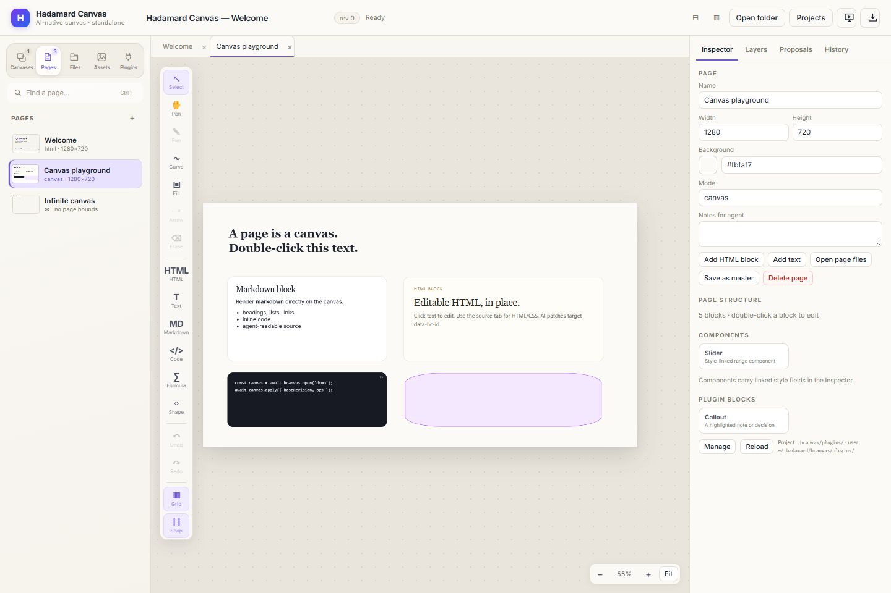

  
Hadamard Canvas · v0.1.6

  <h1>Make the page the workspace.</h1>
  
Hcanvas is a local-first canvas for serious visual work. Build pages, slides and diagrams, then let people and agents edit the same document through one clean, JSON-first interface.

  

    <a class="hc-btn hc-btn-primary" href="#install">Install Hcanvas</a>
    <a class="hc-btn" href="https://github.com/DeconBear/hadamard/releases">Download for desktop</a>
  

  
Local-first · Human + agent · HTML + Canvas + Infinite

  
  
The same document in Hcanvas: canvas pages, editable HTML, Markdown, code blocks and an inspector for people and agents.

## What you can build

  
<h3>HTML pages</h3>
Write and edit real HTML, preview it in a sandbox, or open the source editor when you want full control.

  
<h3>Canvas pages</h3>
Mix text, Markdown, code, images, shapes, formulas, curves and connectors on a fixed slide surface.

  
<h3>Infinite diagrams</h3>
Pan and zoom without page bounds — useful for research maps, system diagrams and early thinking.

  
<h3>Documents that ship</h3>
Export HTML, PDF, PNG, visual or editable PPTX, and DOCX. Present full-screen with speaker notes.

## Install

### Desktop app

Download the installer for your platform from [GitHub Releases](https://github.com/DeconBear/hadamard/releases):

- **Windows:** `Hadamard-Canvas-Setup-*.exe` or the portable `.exe`
- **macOS:** `Hadamard-Canvas-*.dmg` or `.zip` for x64 and arm64
- **Linux:** `Hadamard-Canvas-*.AppImage` or `Hadamard-Canvas-*.deb` for x64

The desktop installers include the Electron app only. Install the CLI separately when you want terminal or agent commands.

### CLI and agent commands

~~~bash
npm install -g hadamard-canvas
hcanvas desktop --workspace ~/.hcanvas
~~~

Node.js 22.13+ or Node.js 24 is required. The interactive UI runs in the Electron desktop window:

~~~bash
hcanvas desktop --workspace ~/.hcanvas  # Electron desktop window
~~~

## First 10 minutes

1

<strong>Choose a workspace</strong>
Start with <code>~/.hcanvas</code>, or pass <code>--project &lt;dir&gt;</code> to keep a deck, report or research project self-contained.

2

<strong>Make a page</strong>
Use an HTML page for a landing page, a Canvas page for a slide, an Infinite page for a diagram, or a Markdown page for a paper.

3

<strong>Add real content</strong>
Double-click text to edit. Add Markdown, code, images, shapes, formulas or a component from the block library.

4

<strong>Bring in an agent</strong>
Agents read the document through <code>hcanvas</code> and write patches with stable revisions. Human edits and agent edits use the same model.

5

<strong>Present or export</strong>
Present the deck, restore a revision from History, or export a PDF, PNG, PPTX or DOCX for delivery.

## Let an agent work on it

Give your agent the document context and a small, reviewable patch. Useful commands:

~~~bash
# Read the current document outline
hcanvas read --format outline

# Create a new canvas document
hcanvas docs create --title "Research sync" --preset canvas

# Apply a reviewed patch against a known revision
hcanvas apply --ops-file changes.json --base-revision 5 --actor my-agent
~~~

Need a stable target? Open the page Inspector and copy **Canvas ID** / **Page ID**, or right-click a page in the sidebar for the same copy actions.

<strong>Installing with an agent?</strong> Point it at the <a href="https://github.com/DeconBear/hadamard#quick-start-with-ai-agents">Quick start with AI Agents</a> section in the README. The desktop and CLI are separate installs: the desktop installer provides the GUI, while <code>npm install -g hadamard-canvas</code> provides the CLI and launcher.

## Extensions and kernels

Hcanvas extensions are v2 packages with a `manifest.json`; built-in Notebook and the three bundled kernel extensions ship with the app. Open **Extensions** from the workspace to install a folder, install an exact npm package, enable/disable, trust, or uninstall:

~~~bash
hcanvas extension list
hcanvas extension install @hcanvas/kernel-python@0.1.0 --user
hcanvas extension install --folder ./my-extension --project
hcanvas extension install --tarball ./my-extension.tgz --project
hcanvas extension update @hcanvas/kernel-python@0.1.0 --user
hcanvas extension uninstall <extension-id> --user
hcanvas doctor
~~~

NPM distribution is a **Preview** channel for the official `@hcanvas/*` kernel packages; the bundled kernels shipped with the app are the stable path. User extensions live under your Hcanvas data root; project extensions live in `.hcanvas/extensions/`. Process-backed extensions (kernels, sidecars, terminals, tools) stay disabled in Restricted Mode; they need an explicit Trust decision after you trust the workspace. `hcanvas doctor` reports Node, Python, g++, GNU Octave and extension compatibility.

## Settings

Open **Project Hub → Settings** in the desktop app. The dialog stores preferences in `hcanvas-settings.json` under the Hcanvas config directory.

- **Runtimes**: optional absolute paths for Python, GNU Octave and the C++ compiler (`g++`/`clang++`). Empty means auto-detect from `PATH` (Windows Octave also checks the uninstall registry). Use **Test** to verify a path and **Auto-detect all** to probe the machine. Changes apply to new kernel sessions; running sessions keep their current interpreter.
- **General**: interface language (English/中文) and the data location. Changing the data location still requires a desktop restart.
- **Notebook**: default kernel for new Notebook pages and the local output-cache budget for `.hnb.md` files; clear cached outputs from the same panel.
- **Updates**: check for updates now, auto-check on startup, auto-download, and the stable/preview channel. Automatic install is available in packaged desktop builds; CLI users update through their installer or npm.

`hcanvas doctor` reads the same runtime settings and reports whether each runtime came from a configured path or auto-detection.
## Notebooks

Create a Notebook page from **Pages**, or open a `.hnb.md` file from **Files**. Markdown is edited directly in the continuous document; code cells run through enabled kernel extensions. Kernel completion opens while typing or with **Ctrl+Space**; press **Tab** to accept the selected completion. Variables keep separate **initial** and **current** values: Initialize/Run all applies initial values, while normal runs publish current values. Shared variables flow across Python, C++ and GNU Octave kernels.

Notebook outputs are cached in the local Hcanvas profile for `.hnb.md` files, and stored in the native page for Notebook pages. HTML export embeds the visible output (including image assets) so it can be opened outside Hcanvas. Jupyter `.ipynb` files are not imported or exported.

## Keep exploring

- [Hcanvas reference](./hadamard-canvas.md) — page types, blocks, CLI protocol, plugins and storage
- [Extension authoring](./hcanvas-extensions.md) — npm package layout, version rules, trust and publishing
- [Hcanvas on npm](https://www.npmjs.com/package/hadamard-canvas)
- [Hadamard Harness](./hadamard-harness.md) — the agent runtime for engineering and research
