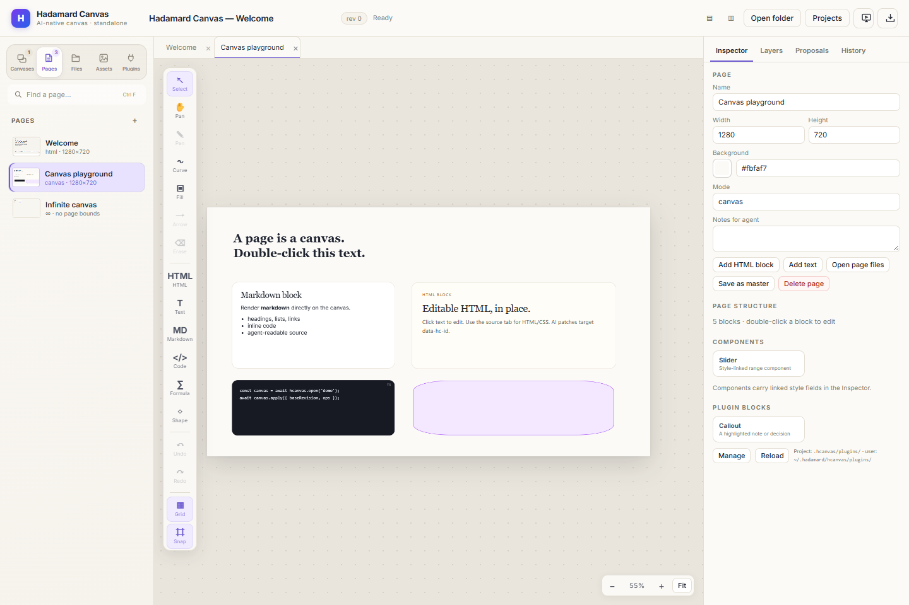

  
Hadamard Canvas · v0.1.2

  <h1>让页面 成为工作空间。</h1>
  
Hcanvas 是面向严肃视觉工作的本地优先画布。在这里做页面、幻灯片和图示，再让人类与 Agent 通过同一套 JSON-first 接口编辑同一份文档。

  

    <a class="hc-btn hc-btn-primary" href="#安装">安装 Hcanvas</a>
    <a class="hc-btn" href="https://github.com/DeconBear/hadamard/releases">下载桌面版</a>
  

  
本地优先 · 人类 + Agent · HTML + Canvas + Infinite

  
  
同一份 Hcanvas 文档：Canvas 页面、可编辑 HTML、Markdown、代码块，以及人和 Agent 共用的检查器。

## 可以做什么

  
<h3>HTML 页面</h3>
编写并直接编辑真实 HTML，在沙箱中预览；需要完全控制时打开源码编辑器。

  
<h3>Canvas 页面</h3>
在固定幻灯片画布上混合文本、Markdown、代码、图片、形状、公式、曲线和连接线。

  
<h3>Infinite 图示</h3>
无页面边界，自由缩放和平移，适合科研图谱、系统架构图和早期思考。

  
<h3>可交付文档</h3>
导出 HTML、PDF、PNG、视觉或可编辑 PPTX、DOCX，并支持带演讲者备注的全屏演示。

## 安装

### 桌面版

从 [GitHub Releases](https://github.com/DeconBear/hadamard/releases) 下载对应平台的安装包：

- **Windows：**`Hadamard-Canvas-Setup-*.exe` 或便携版 `.exe`
- **macOS：**x64 与 arm64 的 `Hadamard-Canvas-*.dmg` 或 `.zip`
- **Linux：**x64 的 `Hadamard-Canvas-*.AppImage` 或 `Hadamard-Canvas-*.deb`

桌面安装包只包含 Electron 应用。如果需要终端或 Agent 命令，请另外安装 CLI。

### CLI 与 Agent 命令

~~~bash
npm install -g hadamard-canvas
hcanvas desktop --workspace ~/.hcanvas
~~~

要求 Node.js 22.13+ 或 Node.js 24。npm 包同时提供浏览器和 headless 模式：

~~~bash
hcanvas app --workspace ~/.hcanvas      # 本地服务 + 浏览器界面
hcanvas serve --workspace ~/.hcanvas --port 4319
~~~

## 10 分钟上手

1

<strong>选择工作目录</strong>
从 <code>~/.hcanvas</code> 开始，或用 <code>--project &lt;目录&gt;</code> 把演示、报告或研究项目独立管理。

2

<strong>创建页面</strong>
落地页用 HTML 页面，幻灯片用 Canvas 页面，架构图用 Infinite 页面，论文用 Markdown 页面。

3

<strong>加入真实内容</strong>
双击文本即可编辑；从块库添加 Markdown、代码、图片、形状、公式或组件。

4

<strong>让 Agent 加入</strong>
Agent 通过 <code>hcanvas</code> 读取文档，并基于稳定 revision 写入 patch；人类编辑和 Agent 编辑共用同一份模型。

5

<strong>演示或导出</strong>
全屏演示、从历史记录恢复 revision，或导出 PDF、PNG、PPTX、DOCX 交付。

## 让 Agent 协作

给 Agent 文档上下文，并让它生成可审阅的小 patch。常用命令：

~~~bash
# 读取当前文档大纲
hcanvas read --format outline

# 创建新的 Canvas 文档
hcanvas docs create --title "研究同步" --preset canvas

# 基于已知 revision 应用审阅后的 patch
hcanvas apply --ops-file changes.json --base-revision 5 --actor my-agent
~~~

需要稳定目标？打开页面 Inspector 复制 **Canvas ID** / **Page ID**，或右键侧边栏中的页面使用同样的复制操作。

<strong>用 Agent 安装？</strong>让它阅读 README 的 <a href="https://github.com/DeconBear/hadamard#quick-start-with-ai-agents">Quick start with AI Agents</a> 部分。桌面版和 CLI 是分开安装的：桌面安装包提供 GUI，<code>npm install -g hadamard-canvas</code> 提供 CLI 和桌面启动器。

## 继续探索

- [Hcanvas 完整参考](./hadamard-canvas.md)——页面类型、块、CLI 协议、插件与存储
- [npm 上的 Hcanvas](https://www.npmjs.com/package/hadamard-canvas)
- [Hadamard Harness](./hadamard-harness.md)——面向工程和科研的 agent runtime
